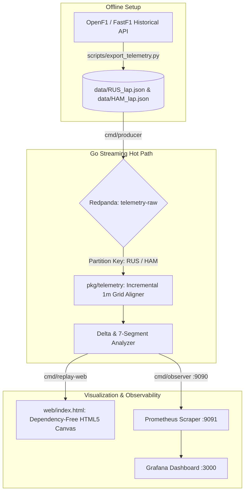

# ghost-lap

> **Disclaimer**: `ghost-lap` is a personal educational project that replays historical Formula 1 qualifying session telemetry as if it were live. It is not connected to a live car feed and must never be described as live telemetry or a race-strategy tool.

## Overview

`ghost-lap` is a Go streaming pipeline that replays historical qualifying telemetry through Redpanda, aligns two drivers (`RUS` vs. `HAM`, 2024 Silverstone Qualifying Q3) onto a common 1.0 m spatial distance grid, and computes a continuous distance-aligned time delta showing who is ahead, by how much, and in which track segment the gap was won or lost.

## Architecture


## Documentation Index
- [Architectural Trade-Off](docs/tradeoffs.md): Engineering decisions behind offline export, Redpanda partitioning, arc-length projection vs. speed integration, linear vs. spline resampling, incremental state buffering, and bounded Prometheus label cardinality.

- [Spatial Alignment & Validation Proofs](docs/alignment-testing.md): Empirical comparison of distance methods (`14.040 m` integration drift vs. `0.000 m` grid projection), ground-truth lap delta validation (`+0.1710 s` official gap, `0.00 ms` finish error), seeded sample-loss degradation (`5%`, `10%`, `25%`), and 7-segment gap breakdown.

- [Verification & Execution Log: Reproducible CLI commands, raw terminal measurements, and verification checks across Stages 0 through 9.

## Setup & Reproduction
### Prerequisites
- Go 1.21+

- Python 3.10+ (`requests` / `fastf1`)

- Docker (optional, for Redpanda, Prometheus, and Grafana)

1. Re-Download Historical Telemetry
Raw telemetry files in data/ are gitignored. Regenerate the 2024 Silverstone Q3 dataset locally:

```bash
python3 scripts/export_telemetry.py
```
2. Run Alignment and Validation Checks
```bash
# Distance drift comparison (integration vs. projection)
go run cmd/distance-check/main.go

# 1.0m uniform distance grid resampling and physical bounds check
go run cmd/resample-check/main.go

# Ground-truth finish-line delta check (+0.1710s)
go run cmd/delta-check/main.go

# Incremental streaming vs. batch equivalence check
go run cmd/stream-check/main.go

# Seeded sample-loss degradation test (5%, 10%, 25%)
go run cmd/degrade-check/main.go

# Per-segment gap breakdown (7 Silverstone segments)
go run cmd/segment-check/main.go
```

3. Run Track Replay View & Observability
```bash
# Serve dependency-free HTML5 canvas track replay at http://localhost:8080
go run cmd/replay-web/main.go -addr=:8080

# Expose Prometheus metrics (/metrics) and aligned trace JSON (/api/trace) at :9090
go run cmd/observer/main.go -addr=:9090
```

## Data Source and Attribution Note
Historical timing and car telemetry originate from public OpenF1 / FIA session records for the 2024 British Grand Prix Qualifying session (Silverstone, session key `9558`), used strictly for non-commercial personal learning. Drivers are identified solely by three-letter timing codes (`RUS`, `HAM`). No Formula 1 or team logos, trademarks, or proprietary branding are included in this repository.
