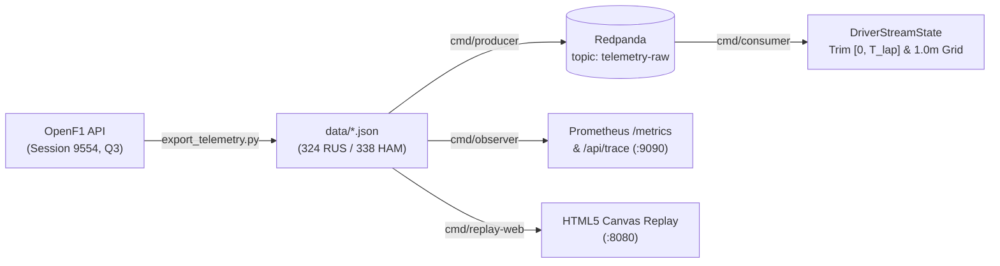

# ghost-lap

> **Disclaimer**: `ghost-lap` is a personal educational project that replays historical Formula 1 qualifying session telemetry as if it were live. It is not connected to a live car feed and must never be described as live telemetry or a race-strategy tool.

## Overview
`ghost-lap` is a Go streaming pipeline that replays historical qualifying telemetry through Redpanda (`telemetry-raw`), aligns two drivers (`RUS` vs. `HAM`, 2024 British Grand Prix Qualifying Q3, OpenF1 Session Key `9554`) onto a common `1.0 m` spatial arc-length grid, and computes continuous uncalibrated time deltas and per-segment breakdowns.

## Architecture



1. **Offline Export (`scripts/export_telemetry.py`)**: Resolves 2024 Silverstone Qualifying (`session_key=9554`) via the public OpenF1 REST API, extracts each driver's fastest Q3 lap (`RUS` Lap 25: `85.819 s`, `324` raw samples at `3.74 Hz`; `HAM` Lap 24: `85.990 s`, `338` buffered samples at `3.88 Hz`, `335` inside `[0.0, 85.990]`), and exports JSON files to `data/`.
2. **Redpanda Replay and Consumer (`cmd/producer`, `cmd/consumer`, `pkg/telemetry`)**: Publishes chronologically sorted driver frames to Redpanda (`telemetry-raw`), trims samples strictly to `[0.0 s, official_lap_time]`, projects 2D coordinates (decimeters $\to$ meters) onto a uniform `1.0 m` grid, and computes incremental time deltas without finish-line calibration.
3. **Track Replay and Observability (`cmd/replay-web`, `cmd/observer`, `deploy/`)**: Renders the two-driver circuit replay on a dependency-free HTML5 `<canvas>` (`:8080`) and exposes bounded-cardinality Prometheus metrics (`/metrics`) plus aligned trace JSON (`/api/trace`) at `:9090`.

## Documentation Index
* **Architectural Trade-Offs** ([`docs/tradeoffs.md`](docs/tradeoffs.md)): Engineering decisions behind OpenF1 offline export, Redpanda partitioning, speed integration vs. 2D arc-length projection, linear resampling, incremental state buffering, and bounded Prometheus label cardinality.
* **Spatial Alignment and Validation Proofs** ([`docs/alignment-testing.md`](docs/alignment-testing.md)): Distance method comparison (`3.042 m` integration drift vs. `5.376 m` racing-line path difference), uncalibrated finish-line delta evaluation (`+0.2560 s` computed vs. `+0.1710 s` official, `84.99 ms` error), seeded sample-loss degradation (`5%`, `10%`, `25%`), and 7-segment speed/delta validation.
* **Verification and Execution Log** ([`docs/verification.md`](docs/verification.md)): Reproducible CLI commands, raw terminal output, Prometheus `/metrics` scrape output, and visual evidence screenshots.

## Setup and Reproduction

### Prerequisites
* Go 1.22+
* Python 3.11+ (`requests`)
* Docker (optional, for Redpanda, Prometheus, and Grafana)

### 1. Re-Download Historical Telemetry
Raw telemetry files in `data/` are gitignored. Regenerate the 2024 Silverstone Q3 dataset locally:
```bash
python3 scripts/export_telemetry.py
```

### 2. Run Alignment and Validation Checks
```bash
# Distance comparison (km/h->m/s speed integration vs. 2D arc-length projection)
go run cmd/distance-check/main.go

# 1.0m uniform distance grid resampling and physical bounds check
go run cmd/resample-check/main.go

# Uncalibrated finish-line delta comparison against official gap (+0.1710s)
go run cmd/delta-check/main.go

# Incremental streaming vs. batch equivalence check
go run cmd/stream-check/main.go

# Seeded sample-loss degradation test (5%, 10%, 25%, endpoints anchored)
go run cmd/degrade-check/main.go

# Per-segment gap breakdown and physical speed realism check (35-90 m/s)
go run cmd/segment-check/main.go
```

### 3. Run Redpanda Producer and Consumer Loop
```bash
docker compose -f deploy/docker-compose.yml up -d redpanda
go run cmd/producer/main.go -brokers=localhost:9092 -speed=20.0
go run cmd/consumer/main.go -brokers=localhost:9092 -expected=659
```
### 4. Run Track Replay View and Observability
```bash
# Serve dependency-free HTML5 canvas track replay at http://localhost:8080
go run cmd/replay-web/main.go -addr=:8080

# Expose Prometheus metrics (/metrics) and aligned trace JSON (/api/trace) at :9090
go run cmd/observer/main.go -addr=:9090
```
## Data Source and Attribution Note
​Historical timing and car telemetry originate from public OpenF1 API records (`https://api.openf1.org/v1`) for the 2024 British Grand Prix Qualifying session (Silverstone, `session_key=9554`, July 6, 2024), used strictly for non-commercial personal learning for non-commercial personal learning. Drivers are identified solely by three-letter timing codes (`RUS`, `HAM`). No Formula 1, FIA, or team logos, trademarks, or proprietary branding are included in this repository.
