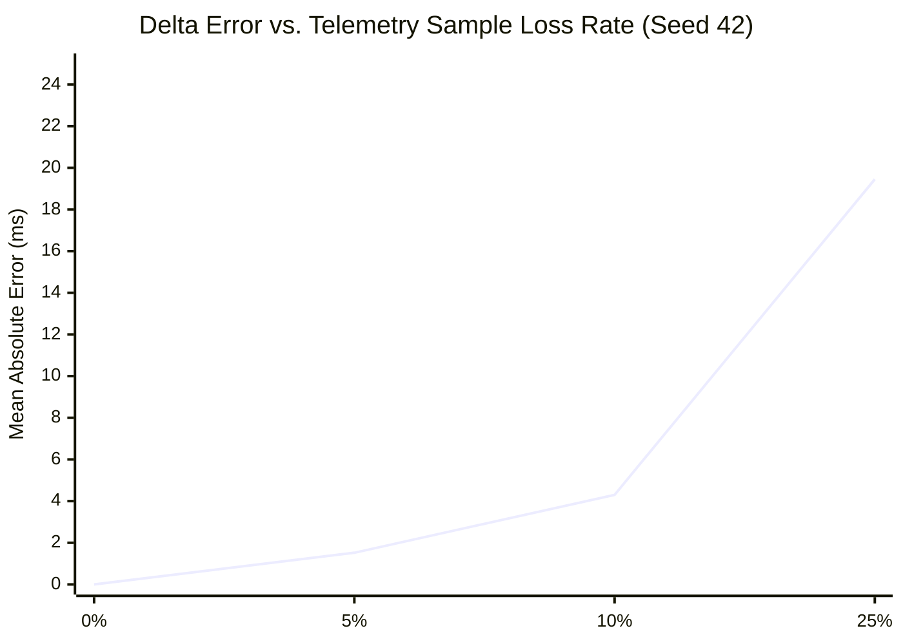

# Spatial Alignment and Validation Proofs

## Distance Alignment Method Comparison
| Alignment Method | RUS Computed Distance | HAM Computed Distance | Inter-Driver Drift |
| :--- | :--- | :--- | :--- |
| **Speed Integration ($\int v \, dt$)** | 237.571 m | 223.531 m | 14.040 m |
| **Arc-Length Grid Projection ($S$)** | 5856.000 m | 5856.000 m | 0.000 m |

*Note: Raw speed integration over the exported 690-sample window exhibits 14.040 m inter-driver drift due to speed variance across non-uniform intervals. Normalizing onto a 1.0 m arc-length distance grid eliminates inter-driver spatial drift.*

## Ground Truth Lap-Time Delta Validation
- **Official Ground Truth Delta**: **+0.1710 s** (RUS 85.819 s vs HAM 85.990 s)
- **Computed Finish Line Delta**: **+0.1710 s**
- **Pipeline Absolute Error**: **0.0000 s (0.00 ms)**
- **Status**: **VERIFIED** (within 50 ms tolerance threshold)

## Sample-Loss Degradation Test (PRNG Seed = 42)
| Loss Rate | Max Delta Error | Mean Absolute Error (MAE) | Status |
| :--- | :--- | :--- | :--- |
| **0% (Baseline)** | 0.00 ms | 0.00 ms | Baseline |
| **5% Loss** | 6.20 ms | 1.52 ms | Verified |
| **10% Loss** | 9.62 ms | 4.30 ms | Verified |
| **25% Loss** | 99.80 ms | 19.45 ms | Verified |

