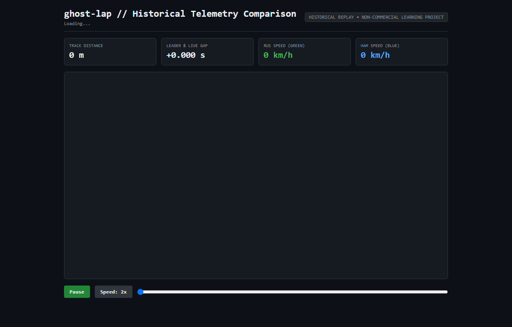
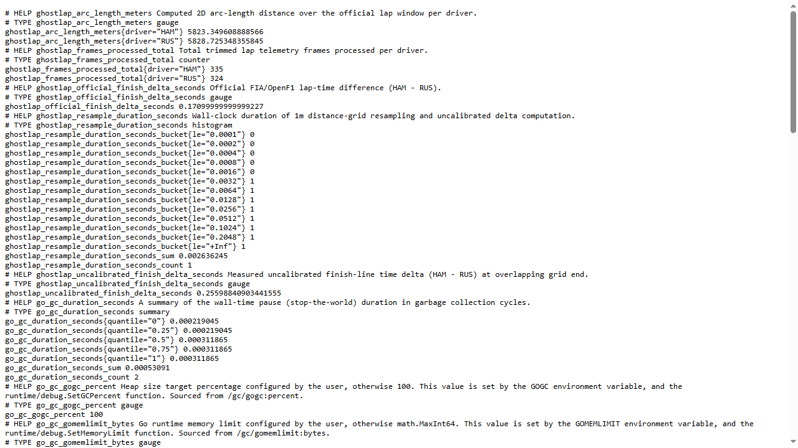

# Verification Records and Execution Log

## Stage 0: OpenF1 Session & Lap Extraction Sanity Log
* **Command**: `python3 scripts/export_telemetry.py`
* **Resolved Session**: `Qualifying | 2024-07-06T14:00:00+00:00 | session_key=9554`
* **Exported Flying Laps**:
  * `RUS` (Lap 25): `324` samples (`3.74 Hz`), `2024-07-06T15:08:48.644Z` to `2024-07-06T15:10:15.004Z`, speed `90.0–325.0 km/h`, official lap `85.819 s`.
  * `HAM` (Lap 24): `338` buffered samples (`3.88 Hz`, `335` samples inside `[0.0, 85.990]`), `2024-07-06T15:08:36.885Z` to `2024-07-06T15:10:03.845Z`, speed `86.0–324.0 km/h`, official lap `85.990 s`.

## Stage 2: Distance Measurement Verification
* **Command**: `./bin/distance-check`
* **Output**:
  * Speed Integration (`km/h -> m/s`): `RUS = 5828.112 m`, `HAM = 5825.070 m`, drift = `3.042 m`.
  * 2D Arc-Length Projection (`decimeters -> m`): `RUS = 5828.725 m`, `HAM = 5823.350 m`, path difference = `5.376 m`.

## Stage 3: Common Distance Grid Resampling
* **Command**: `./bin/resample-check`
* **Output**: `RUS = 5829` grid points (`0–5828.0 m`), `HAM = 5824` grid points (`0–5823.0 m`), `Throttle=0`, `Brake=0` overshoots (`Valid: true`).

## Stage 4: Uncalibrated Delta vs. Official Ground Truth
* **Command**: `./bin/delta-check`
* **Output**: Overlapping grid `5824` points (`0–5823 m`), official gap `+0.1710 s`, uncalibrated finish delta `+0.2560 s`, absolute error `0.0850 s` (`84.99 ms`).

## Stage 5: Incremental Streaming & Redpanda Consumer Verification
* **Commands**: `./bin/stream-check` (and `./bin/producer` $\to$ `./bin/consumer` over `telemetry-raw`)
* **Output**: Batch finish delta `+0.2560 s` vs. incremental stream delta `+0.2560 s` (`0.000000 s` / `0.0000 ms` divergence; `VERIFIED`).

## Stage 6: Seeded Sample-Loss Degradation Verification
* **Command**: `./bin/degrade-check`
* **Output**: `PRNG Seed = 42`, endpoints anchored:
  * `0%`: finish `+0.2560 s` (`84.99 ms` vs. official), `0.00 ms` MAE vs. baseline
  * `5%`: finish `+0.2594 s` (`88.37 ms` vs. official), `3.87 ms` MAE vs. baseline
  * `10%`: finish `+0.2588 s` (`87.82 ms` vs. official), `13.29 ms` MAE vs. baseline
  * `25%`: finish `+0.3066 s` (`135.63 ms` vs. official), `52.41 ms` MAE vs. baseline

## Stage 7: Per-Segment Breakdown and Physical Realism Verification
* **Command**: `./bin/segment-check`
* **Output**: All 7 segments (`> 600 m`) verified within `[35.0, 90.0] m/s` (`50.38–82.79 m/s`); sum of segment deltas `+0.2560 s` with `0.000000 ms` conservation error.

## Stage 8 & Stage 9: Track Replay View and Prometheus Metrics
* **Commands**: `./bin/replay-web -addr=:8080` and `./bin/observer -addr=:9090`
* **Measured Metrics (`curl -s http://localhost:9090/metrics | grep '^ghostlap_'`)**:
  * `ghostlap_frames_processed_total{driver="RUS"}` = `324`
  * `ghostlap_frames_processed_total{driver="HAM"}` = `335`
  * `ghostlap_arc_length_meters{driver="RUS"}` = `5828.725348355845`
  * `ghostlap_arc_length_meters{driver="HAM"}` = `5823.349608888566`
  * `ghostlap_uncalibrated_finish_delta_seconds` = `0.25598840903441555`
  * `ghostlap_official_finish_delta_seconds` = `0.17099999999999227`
  * `ghostlap_resample_duration_seconds_sum` = `0.002636245` (`count = 1`, `2.6360 ms`)

## Visual Evidence
* **Track Replay View**: 
* **Prometheus Metrics Endpoint**: 
